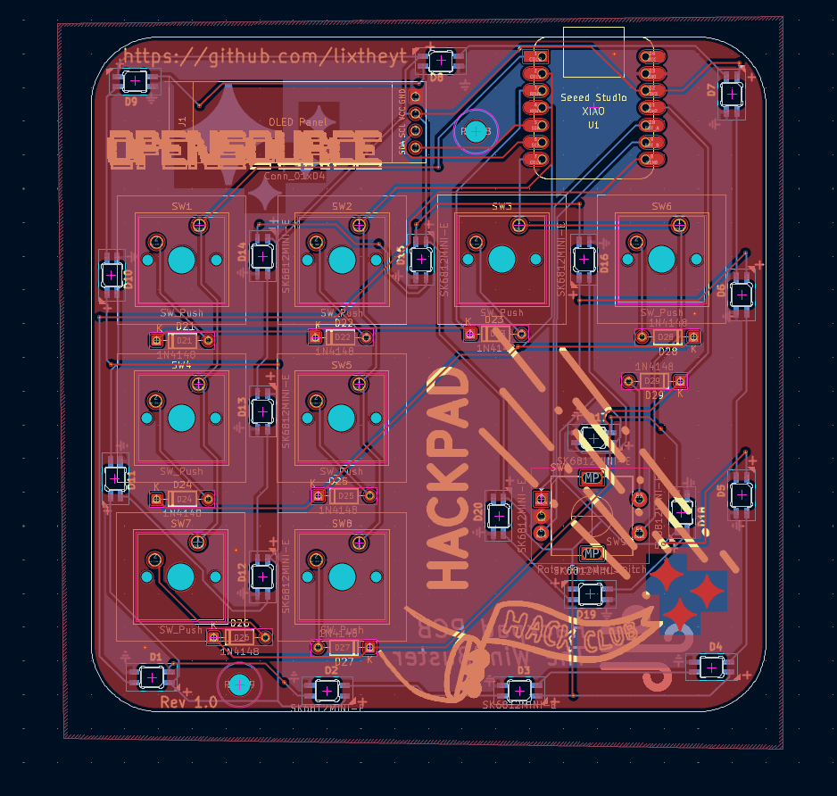

# mediapad

A 9-key media macropad: 8 Cherry MX switches plus an EC11 rotary encoder with a
push switch, a 128x32 SSD1306 OLED and a chain of SK6812 MINI-E underglow LEDs,
driven by a Seeed XIAO RP2040.

* Keyboard Maintainer: [Lix](https://github.com/lixtheyt)
* Hardware Supported: mediapad PCB + XIAO RP2040
* Hardware Availability: https://github.com/lixtheyt/mediapad

## Revisions

The board comes in two LED populations, so the firmware is split into two
revisions. They differ only in `rgb_matrix.layout`; the keymap, the OLED, the
encoder and every effect are shared.

| Revision | LEDs | Board |
| --- | --- | --- |
| `rev20` | D1-D20 | fully populated, the default build |
| `rev16` | D1-D16 | built without the four LEDs ringing the encoder |

The four LEDs `rev16` leaves out (D17-D20) are the last in the WS2812 chain, so
the remaining sixteen still light normally on a board that never had them
fitted. SW8 and SW9 lose their per-key LED and the reactive effects skip those
two positions; nothing else changes.

Flashing `rev20` onto a 16-LED board is not harmful, but the effects will run
as if four LEDs existed past the end of the chain, so a fifth of every animation
is spent lighting nothing. The RGB layers put the compiled-in LED count on the
OLED (`20L` / `16L`) so it is easy to confirm which build is on the board.

## Building

    make mediapad/rev20:lixtheyt
    make mediapad/rev16:lixtheyt

Flashing:

    make mediapad/rev20:lixtheyt:flash

There is no bare `make mediapad:lixtheyt` target - modern QMK dropped
`DEFAULT_FOLDER`, so the revision has to be named.

See the [build environment setup](https://docs.qmk.fm/#/getting_started_build_tools) and the [make instructions](https://docs.qmk.fm/#/getting_started_make_guide) for more information. Brand new to QMK? Start with our [Complete Newbs Guide](https://docs.qmk.fm/#/newbs).

## Using it

Clicking the encoder opens a mode picker that previews rather than switches:

* **Click** - opens it, showing the mode you are already in
* **Turn while it is open** - walks the list (Volume, Track skip, Arrows,
  Scroll, Zoom, RGB); nothing has changed yet
* **Click again** - confirms, and only now does the mode change
* **Let it lapse** - stays exactly where you were

Confirming is deliberate: a stray turn can no longer drop the board into the RGB
mode and re-apply its effect behind your back. The picker is the only way into
the RGB mode, so no media key is spent on the LEDs.

On the five media modes all eight switches stay media keys and only the dial
changes. The RGB mode is the one place the keys change meaning, and nothing
there falls through to playback. On the media layers all eight switches stay media keys and
only the dial changes; on the RGB layers the switches become colour controls and
nothing falls through to playback.

### Help browser

Press **play/pause + rewind together**. Turn the encoder to walk the list of
what each key does, click it to be shown the answer - everything goes dark
except the LED under the key that does that job - and press any switch to back
out. The list follows whichever layer it was opened from.

The answer lights the four LEDs nearest that key, brightest first, so it reads
as a place on the board rather than a single pinpoint. That also means it still
points somewhere on `rev16`, which has no LED behind the encoder.

The switches sit like this, which is the order the help list walks:

    SW1 SW2 SW3 SW6
    SW4 SW5
    SW7 SW8      SW9 (encoder, to the right of SW8)

## Bootloader

Enter the bootloader in 3 ways:

* **Bootmagic reset**: Hold down the top left key (play/pause) and plug in the keyboard
* **Physical reset button**: Double-tap the reset button on the XIAO RP2040
* **Key combo**: Hold rewind + fast-forward + mute for 5 seconds

The key combos are only armed on the media layers (0-4). On the two RGB layers
those same switches are the colour selectors, so holding two of them while
mixing a colour would otherwise trip the reboot combo. Tap the encoder to get
back to layer 0 first.
