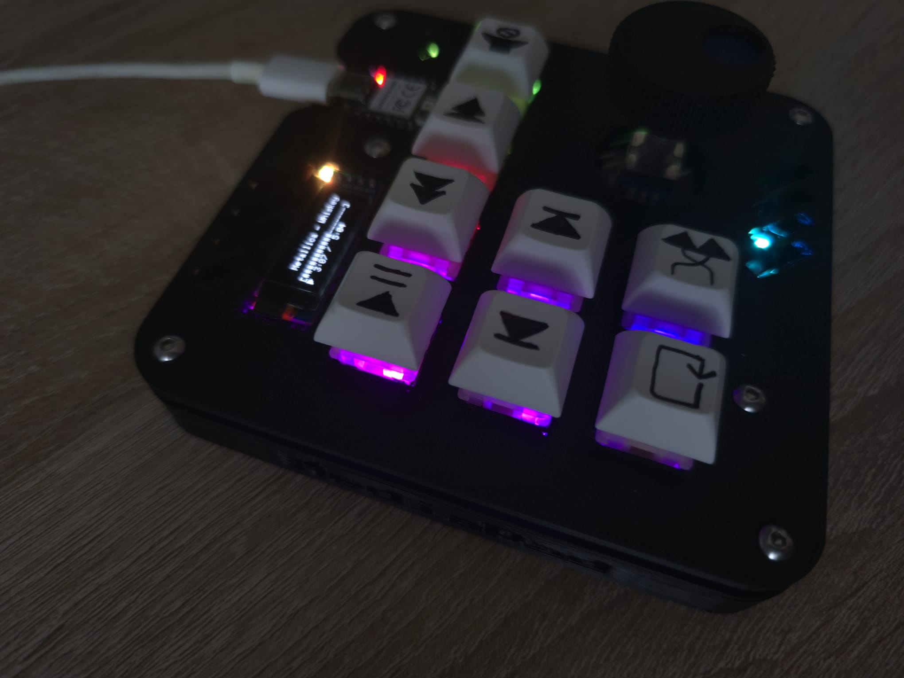
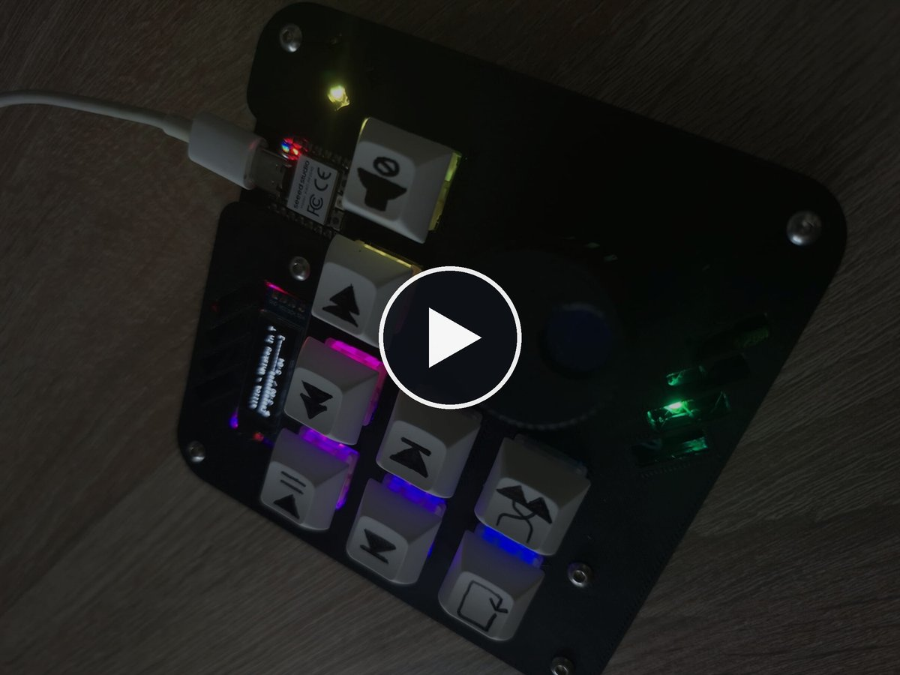
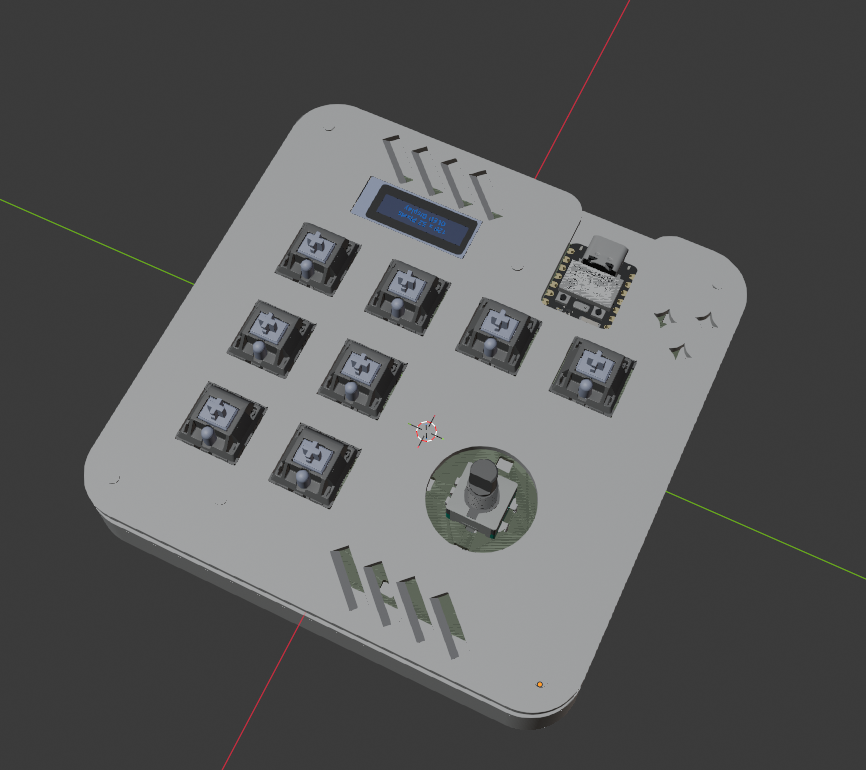
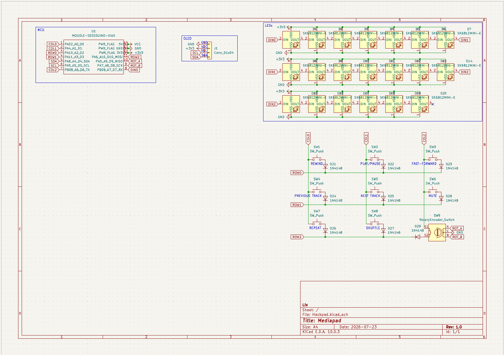
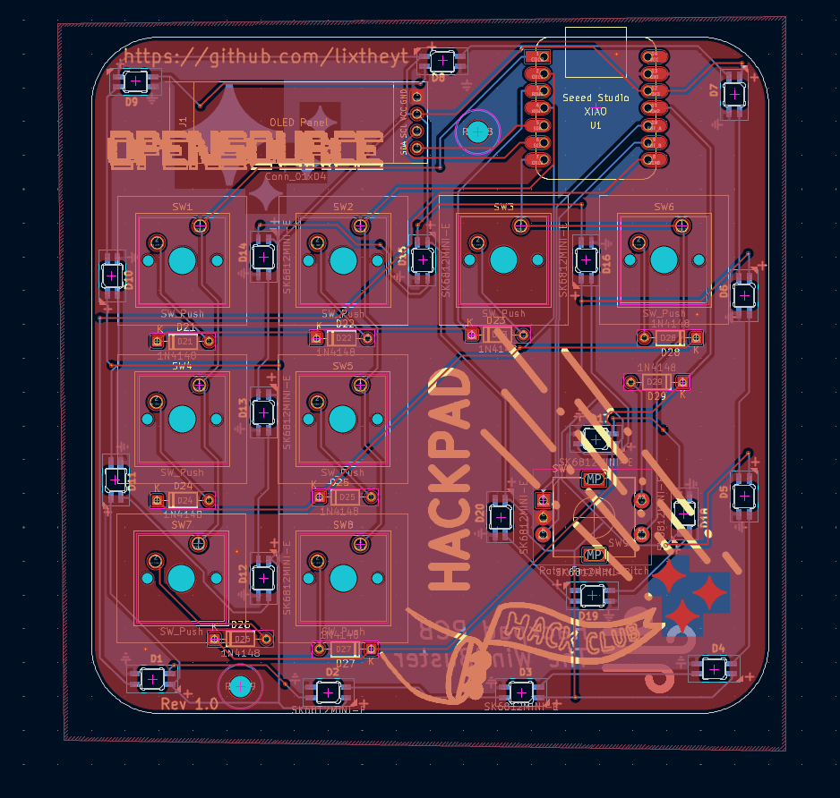
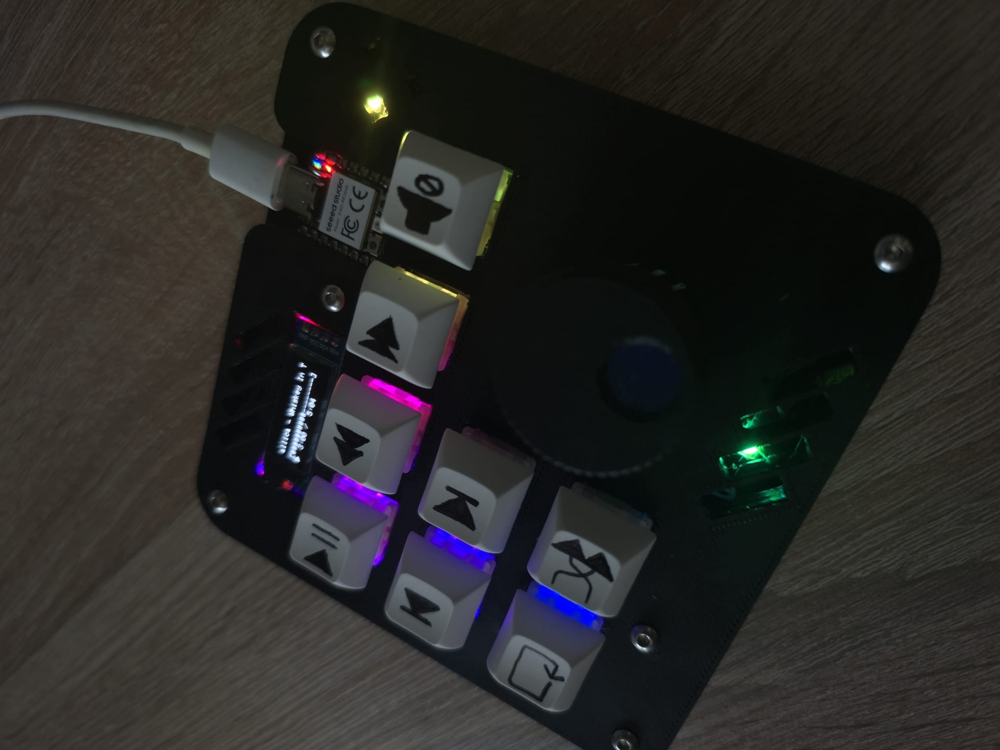
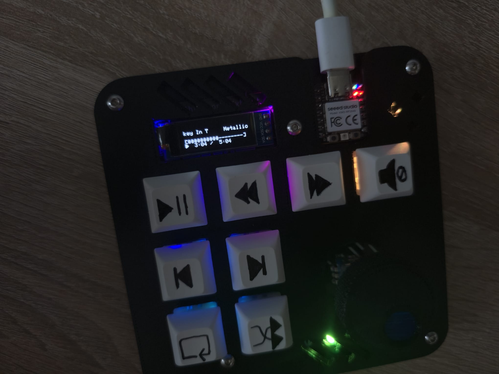

<div align="center">

# MediaPad

**A 9 key hackpad with a rotary encoder, an OLED display and 20 LEDs that controls whatever is playing on your computer, and shows it to you on its own screen.**

[](LICENSE)
[](https://qmk.fm/)
[](https://www.kicad.org/)
[](https://www.blender.org/)
[](#bom)
[](https://stardance.hackclub.com/@lix/projects)<!-- HELYX_STATUS_START -->
<!-- HELYX_STATUS_END -->



</div>

## Table of contents

- [Features](#features)
- [Video](#video)
- [Quick start](#quick-start)
- [Build it yourself](#build-it-yourself)
    - [BOM](#bom)
    - [Case](#case)
    - [PCB](#pcb)
    - [IRL results](#irl-results)
- [Firmware](#firmware)
    - [Two builds](#two-builds)
    - [The keys](#the-keys)
    - [Rotary encoder](#rotary-encoder)
    - [RGB](#rgb)
    - [Help browser](#help-browser)
    - [OLED](#oled)
    - [Hidden key combos](#hidden-key-combos)
- [Companion app](#companion-app)
- [Credits](#credits)
- [License](#license)

## Features

- **128x32 OLED display**, with the title, artist and progress of whatever is playing.
- **EC11 rotary encoder**, which does something different in each of its six modes.
- **20 SK6812 MINI-E LEDs**. We gotta make somethin' for party nah??
- **Eight media keys**, the same on every mode except RGB, where they mix the colours.
- **A cool designed case**, printed in 8 pieces.

## Video

<a href="https://cdn.hackclub.com/01a04d73-aebd-7f39-ae7c-5dad24e6ee75/video_mediapad.mp4">
  
</a>

Click the picture to watch it.

## Quick start

Everything you need to make one is in [`Production`](Production):

| File | What it is |
| --- | --- |
| `gerbers.zip` | the PCB, ready to send to a manufacturer |
| `topCase.stl`, `middleCase.stl`, `bottomCase.stl` | the three parts of the case |
| `spacer.stl` | the spacer for the glow, print 6 |
| `support_display.stl` | the support for the OLED display |
| `mediapad_rev20_lixtheyt.uf2` | firmware for a board with all 20 LEDs |
| `mediapad_rev16_lixtheyt.uf2` | firmware for a board with 16 LEDs |

To flash it, hold the top left key while plugging the board in. It shows up as a drive on your
computer. Copy the `.uf2` that matches your board onto it and it restarts by itself.

Then start [`Companion/mediapad_tray.exe`](Companion), so the display knows what is playing.

## Build it yourself

### BOM

- 8x Cherry MX Switches
- 8x Keycaps
- 6x M3x5x4 Heatset inserts
- 6x M3x16mm Screws
- 8x 1N4148 DO-35 Diodes
- 16x/20x SK6812 MINI-E LEDs (16x = encoder has no LEDs)
- 1x 0.91" 128x32 OLED Display
- 1x EC11 Rotary Encoder
- 1x XIAO RP2040
- 1x Case (1x bottom case, 1x middle case, 1x top case)
- 6x Spacers (printed part)
- 1x Display Support (printed part, use a double-sided tape so it will hold)

### Case

Everything fits together using 6 M3 Bolts and heatset inserts. 4 for the case and 2 for the PCB.

It has 8 separate printed pieces.
3 are parts of the case, 1 is a spacer for the glow and 1 is for the OLED display as a support.



### PCB

I made my PCB inside KiCad.
Libraries I used were originally from the Hackpad website but I also used some that I had found on [grabcad](https://grabcad.com/library).

**Schematic**



**Board**



### IRL results

<div align="center">





</div>

## Firmware

This hackpad uses [QMK](https://qmk.fm/) firmware for everything.

### Two builds

The board exists in two LED populations, so the firmware ships as two revisions.
They differ only in the LED map keys, encoder and OLED are shared.

| Revision | LEDs | Board |
| --- | --- | --- |
| `rev20` | D1-D20 | fully populated |
| `rev16` | D1-D16 | built without the four LEDs ringing the encoder |

The four LEDs `rev16` leaves out are last in the WS2812 chain, so the remaining
sixteen still light normally. The idle screen prints the count
(`mediapad 16 LED`) so you can tell which build is on the board.

```bash
make mediapad/rev20:lixtheyt
```

### The keys

All eight switches are media keys, on every mode except RGB. Only what the
encoder does changes from mode to mode.

```
SW1 play/pause   SW2 rewind       SW3 fast forward   SW6 mute
SW4 prev track   SW5 next track
SW7 repeat       SW8 shuffle      SW9 = the encoder
```

### Rotary encoder

Clicking the encoder opens a mode picker that **previews** rather than switches:

* **Click** - opens it, showing the mode you are already in
* **Turn** - walks the list, nothing has changed yet
* **Click again** - confirms, and only now does the mode change
* **Wait** - it lapses and you stay exactly where you were

1. **Volume** - volume up / down
2. **Track skip** - next / previous track
3. **Arrows** - arrow up / down
4. **Scroll** - mouse wheel up / down
5. **Zoom** - zoom in / out, sent as Ctrl + wheel so it does not depend on your
   keyboard layout
6. **RGB** - the lighting, below

### RGB

RGB contains 16 effects. The first six run their own colours
(Pinwheel, Vortex, Rainbow wave, Chevron, Splash, Raindrops), the other ten come
out in whatever you mix, and several of those react to keypresses and spread
outward from the key you hit.

The keys aim the dial, and the dial does the changing:

```
SW1 red   SW2 green   SW3 blue   SW6 brightness   SW4 effect list
```

Whatever you set is remembered. The colour, the brightness and the effect are saved a few seconds
after you stop turning the dial, so they are still there after you unplug the board.

### Help browser

Press **play/pause + rewind together** if you forget what a key does. Turn the
encoder to walk the list, click it for the answer, press anything to back out.
The list follows whichever mode you opened it from.

The LEDs either side of that key light up
with the key itself as the dark gap between them, and the display spells the
position out in words. The words are the part that always works. The LED grid
sits about half a key pitch off the switch grid, so no single LED can point at a
key without also looking like it points at its neighbour.

### OLED

While something is playing, a scrolling title and artist, a progress bar, and a
bottom row carrying play/pause on the left, the clock, and shuffle / repeat
symbols on the right. The clock runs locally rather than echoing the host,
because Windows only refreshes its playback position every few seconds.

Otherwise: the board name and LED count, the current mode, and either
`waiting for app` (nothing arriving) or `nothing playing` (the app is connected,
but Windows has no media session).

The display turns itself off after five minutes with no key pressed, no turn of the encoder and
nothing playing, so the idle screen does not burn into the OLED. Any key, any turn or a track that
starts playing turns it back on.

### Hidden key combos

Armed on the media modes only. On the RGB mode those same switches are colour
controls.

| Hold | For | Does |
| --- | --- | --- |
| rewind + fast forward + mute | 5 s | bootloader |
| repeat + shuffle + mute | 5 s | clear EEPROM |
| rewind + fast forward | 2 s | reboot |
| repeat + shuffle | 2 s | toggle debug |

You can also reach the bootloader by holding the top left key while plugging in,
or by double-tapping the reset button on the XIAO.

## Companion app

`Companion/mediapad_tray.exe` is a portable application made in Python that feeds MediaPad with the latest
information about current played media on your computer. Without it the OLED shows the board name and
`waiting for app`, everything except the now-playing screen still works.

As I have mentioned... it is a portable application. That means you don't have to install anything.
Just open, mess with it in the tray (where background applications are located) and make sure to enable
the setting that allows it to open on start up of your computer, so you don't have to turn it on manually
every time you turn on your computer. If you've got no idea where the tray with the background applications
is located then please, [google it](https://www.google.com/search?q=Where+is+the+background+tray+located?).

## Credits

- [QMK](https://qmk.fm/), the firmware everything here runs on.
- [KiCad](https://www.kicad.org/) for the PCB and [Blender](https://www.blender.org/) for the case.
- The [Hackpad](https://hackpad.hackclub.com/) guide by Hack Club, where the first libraries came from.

I want to note out that the firmware was mostly done by AI due to my limited C knowledge
and the difficulty to create a firmware that does such advanced things.

## License

[MIT](LICENSE)
